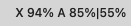
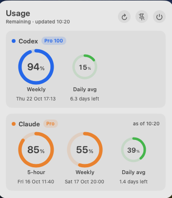

# Usage Bar

<p align="center">
  
</p>

A small macOS menu bar app that shows how much **Codex** and **Claude** quota you have left, side by side.

```
X 60% A 35%|66%
```

- **X**: Codex weekly remaining
- **A**: Claude 5-hour remaining | Claude weekly remaining

Click it for a dashboard with rings, reset times, your plans, and a green **Daily avg** ring
(weekly remaining ÷ days until reset, at least one day). The dashboard can also be pinned to the desktop.

No passwords, no keychain prompts, and no network requests of its own.

<p align="center">
  
  <br>
  
</p>


## Where the data comes from

- **Codex**: the app starts the Codex CLI's local `codex app-server` and calls `account/rateLimits/read`.
  The CLI uses its own sign-in.
- **Claude (auto refresh)**: if the Claude Code CLI is installed and signed in (`claude auth login`),
  the app runs `claude -p /usage` at launch, on Refresh and every 5 minutes. `/usage` is a local
  command: it does not call the model or use quota, and the CLI uses its own sign-in.
- **Claude (status line, optional)**: Claude Code passes `rate_limits` to its
  [status line](https://code.claude.com/docs/en/statusline#rate-limit-usage) command. Clicking
  **Connect Claude Code** sets the status line to `UsageBar --statusline`, which saves those numbers to
  `~/Library/Application Support/Usage Bar/claude-rate-limits.json` and the app reads that file.
  An existing status line keeps working: Usage Bar runs it and shows its output.

Claude numbers update whenever Claude Code receives a reply. The card shows when they were last seen;
once a window's reset time passes it shows as fully available. `rate_limits` is only provided for
Claude Pro and Max subscriptions.

To undo the status line change:

```sh
"/Applications/Usage Bar.app/Contents/MacOS/UsageBar" --disconnect-claude
```

## Build

Requires macOS 13+ and the Xcode command line tools.

```sh
bash scripts/test.sh
ditto "build/Usage Bar.app" "/Applications/Usage Bar.app"
```

`scripts/build.sh` signs with a code-signing certificate named `Usage Bar Signing` when one exists,
otherwise ad-hoc.

## Credits

Usage Bar started from [estay-inc/codex-usage-app](https://github.com/estay-inc/codex-usage-app)
(MIT), a Codex-only menu bar utility. This version adds Claude Code support, the combined menu bar
title, the Daily avg ring and the pinnable dashboard, and drops the localization and DMG packaging.
The original commit history is kept in this repository.

## License

MIT. See [LICENSE](LICENSE).
